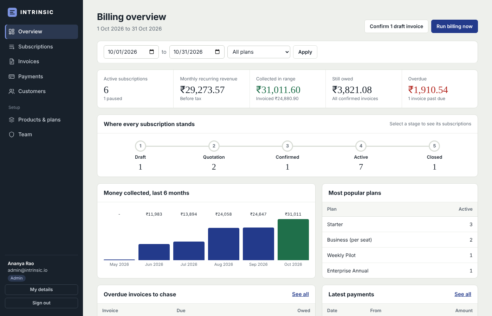
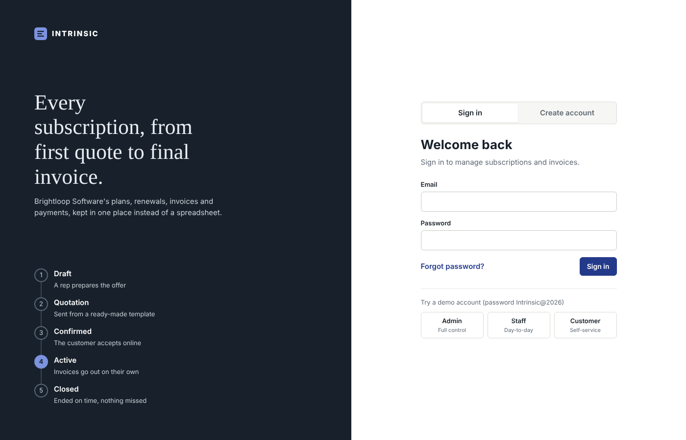
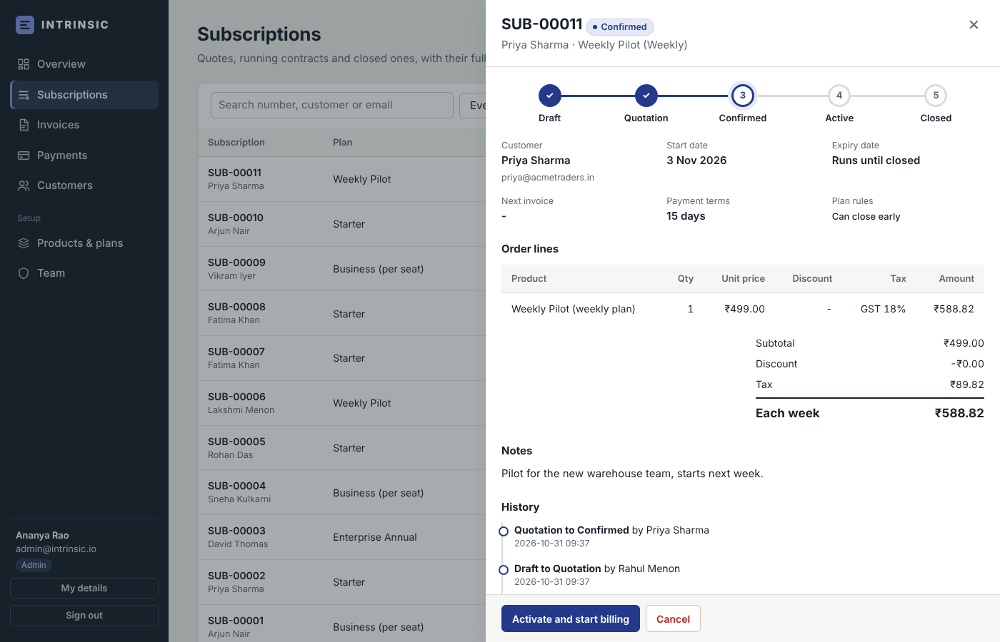
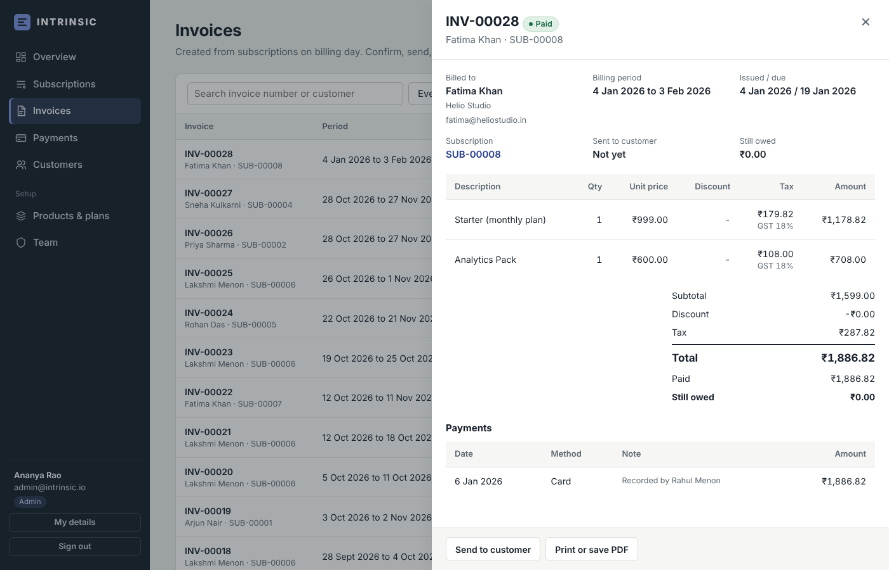
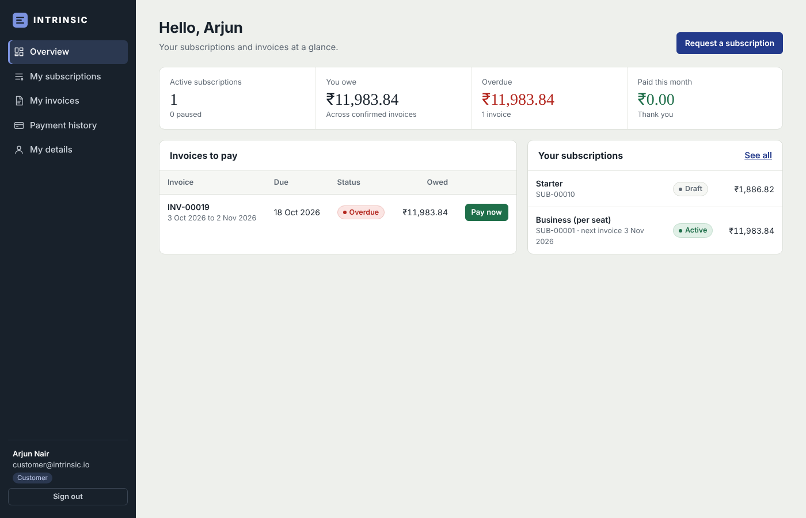

# INTRINSIC - Subscription & Invoicing Management

One system to run plans, subscriptions and recurring billing in one place, from the first quotation to the last payment.

Built for the **Odoo Hackathon** problem statement *"Subscription Management System"* using the fictional company **Brightloop Software**.



---

## Contents

- [What it does](#what-it-does)
- [Quick start](#quick-start)
- [Demo accounts](#demo-accounts)
- [A 5-minute tour](#a-5-minute-tour)
- [How the business rules work](#how-the-business-rules-work)
- [Tech stack](#tech-stack)
- [Project structure](#project-structure)
- [Running the tests](#running-the-tests)
- [Configuration](#configuration)
- [Screenshots](#screenshots)
- [Team](#team)

---

## What it does

Each scene from the problem statement, and how INTRINSIC handles it:

| Scene | What INTRINSIC does |
|---|---|
| **A new customer signs up** | Sign up with email and password. Each email can hold only one account. Passwords must be more than 8 characters, with an uppercase letter, a lowercase letter and a special character, checked live on screen and again on the server. **Forgot password** emails a single-use reset link that expires after 30 minutes. |
| **Different people, different access** | **Admin** controls everything. **Staff** handle customers, subscriptions, invoices and payments, but cannot change the catalog. **Customers** see only their own subscriptions and invoices in a self-service portal. Only the admin can add staff, and public sign-up always creates a customer. |
| **Launching a new plan** | Products have a name, type, sales price, cost price, tax and notes, plus **variants** (for example *Brand: Odoo* adds ₹560 to the price). Plans have a price, a billing period (**daily, weekly, monthly or yearly**), a minimum quantity, availability dates, and per-plan rules: **auto-close at expiry, can close early, can pause, can renew**. |
| **Turning a quote into a subscription** | **Quotation templates** pre-fill the plan and product lines and set how many days the quote stays valid. Each subscription gets its own number, customer, plan, start date, expiry date, payment terms and lines (product, quantity, unit price, tax, amount). It moves **Draft → Quotation → Confirmed → Active → Closed**, every change is recorded in its history, and steps cannot be skipped. |
| **Billing day** | **Run billing** creates every invoice that is due, with customer details, lines, discounts, taxes and totals filled in. A database rule allows only one invoice per subscription per billing period, so **nothing is ever billed twice**, and missed periods are caught up so **nothing is skipped**. Invoices move **Draft → Confirmed → Paid** and can be confirmed, cancelled, sent by email or printed / saved as PDF. |
| **A customer asks for a better price** | Only the admin creates discount rules: **fixed amount or percentage**, minimum purchase or minimum quantity, start and end dates, and a usage limit. A discount applies to a whole subscription or to one product, lands on each new invoice by itself, and **stops on its own** when it expires or runs out. |
| **The money comes in** | Record payments with **method, amount, date and note** against an invoice. Partial payments are supported. Customers can also pay from their portal. Every list shows what is paid, what is still owed, and what is **overdue**. |
| **The finance lead, at the end of the month** | The overview shows active subscriptions, monthly recurring revenue, money collected, money still owed and overdue invoices, with date and plan filters, a stage-by-stage subscription count, six months of collections and the invoices to chase. Lists are paginated and indexed, and a test confirms pages answer in **under 2 seconds with 3,000+ subscriptions**. |

---

## Quick start

You need **Python 3.10 or newer** ([python.org/downloads](https://www.python.org/downloads/)). On Windows, tick **"Add Python to PATH"** during installation.

```bash
# 1. Get the code
git clone https://github.com/betzalfaber/Odoo-hackathon-.git
cd Odoo-hackathon-

# 2. Install the dependencies
pip install -r requirements.txt

# 3. Start the app
python run_server.py
```

Your browser opens **http://127.0.0.1:8000** automatically.

- The database (`intrinsic.db`) is created and filled with demo data the first time you start the app. Delete it to start fresh.
- The interactive API documentation is at **http://127.0.0.1:8000/docs**.
- Everything works **offline**: no internet fonts, CDNs or external services.
- Press **Ctrl + C** in the terminal to stop the server.

---

## Demo accounts

Every demo account uses the password **`Intrinsic@2026`**. The sign-in page also has one-click buttons for each role.

| Role | Email | What to try |
|---|---|---|
| Admin | `admin@intrinsic.io` | Everything: catalog, discounts, taxes, team, billing |
| Staff | `staff@intrinsic.io` | Quotes, subscriptions, billing, payments (catalog is read-only) |
| Customer | `customer@intrinsic.io` | Self-service portal: pay invoices, accept quotes, request subscriptions |

The demo data includes 8 customers, 5 products (two with brand variants), 5 plans covering every billing period, 5 discount rules (one expired, one product-only, one with a usage limit), 3 quotation templates, subscriptions at every stage of the lifecycle, about 30 invoices with months of payment history, a partial payment and two overdue invoices.

---

## A 5-minute tour

1. **Sign in as Admin.** The overview shows the key figures, where every subscription stands, and the overdue invoices to chase.
2. **Open Subscriptions → New subscription.** Pick a customer, choose the template *"Business 10 seats + CRM (Odoo)"* and watch the plan and product lines fill in. Add the code `SEATS15` and save.
3. **Move it through the lifecycle:** *Send quotation → Mark as accepted → Activate and start billing.* The first invoice is created straight away, and the history records each step.
4. **Go to Invoices**, confirm the new draft and select **Record payment** for part of the amount. The invoice shows *Part paid* with the balance still owed. Try **Print or save PDF** and **Send to customer**.
5. **Press Run billing now twice.** The second run creates nothing, because each billing period can only be invoiced once.
6. **Open Products & plans → Discounts.** See the expired code marked as unusable, and the usage counts.
7. **Sign out and sign in as Customer.** Pay the overdue invoice, request a new subscription, then try **Forgot password**. With no mail server configured, the reset link is shown on screen.

---

## How the business rules work

**Subscription lifecycle.** `Draft → Quotation → Confirmed → Active → Closed`. Any open subscription can also be cancelled straight to Closed. Customers can accept or decline a quotation and close their own active subscription when the plan allows it. An expired quotation cannot be accepted.

**Pricing.** Each line is `quantity × unit price`. A product variant adds its extra price to the product's sales price. Discounts come off before tax. Tax is worked out per line from the tax rule on the product or plan. All amounts are rounded half-up to the paisa.

**Billing engine.** Each active subscription keeps its next invoice date. Running billing creates one invoice per due period, oldest first, and moves the date forward by the plan's billing period. Monthly and yearly periods stay on the start day (31 Jan → 28 Feb → 31 Mar). Paused subscriptions are skipped, and paused periods are not billed later. Plans set to auto-close close their subscriptions at expiry. A unique database constraint on *(subscription, period start)* guarantees no period is ever billed twice.

**Discounts.** Checked when a code is entered (it must exist, be active, be within its dates and have uses left) and again on every invoice. Minimum purchase and minimum quantity are measured against the lines the discount applies to. A fixed discount is shared across eligible lines in proportion to their value. Each invoice it lands on counts as one use.

**Payments and overdue.** Payments can only be recorded against confirmed invoices and can never exceed the amount still owed. An invoice becomes *Paid* when its balance reaches zero. A confirmed invoice past its due date with money still owed is shown as *Overdue*.

**Security.** Passwords are stored as salted PBKDF2-SHA256 hashes. Sign-in sessions are random tokens stored server-side, so signing out, deactivating a user or resetting a password ends their sessions immediately. Reset links are stored only as hashes. Every API route checks the user's role, and customers can only ever reach their own records.

---

## Tech stack

| Layer | Technology |
|---|---|
| Backend | Python, **FastAPI**, **SQLAlchemy 2**, Pydantic |
| Database | **SQLite** (foreign keys and WAL mode on). Switch with `DATABASE_URL`. |
| Frontend | Plain HTML, CSS and JavaScript single-page app, with no build step and no external libraries |
| Tests | pytest + FastAPI TestClient |

---

## Project structure

```
Odoo-hackathon-/
├── app/
│   ├── main.py            # FastAPI app, startup, error messages, web page
│   ├── database.py        # Database connection (SQLite by default)
│   ├── models.py          # Tables: users, products, variants, plans, taxes, discounts,
│   │                      #   templates, subscriptions, lines, history, invoices, payments
│   ├── schemas.py         # Validation of every request (password rules, dates, amounts)
│   ├── security.py        # Password hashing, sessions, role checks
│   ├── services.py        # Business rules: pricing, discounts, lifecycle, billing engine
│   ├── serializers.py     # Database rows to JSON
│   ├── mailer.py          # Email (SMTP, or printed to the console in demo mode)
│   ├── seed.py            # Brightloop demo data
│   └── routes/
│       ├── auth.py        # Sign up, sign in, password reset
│       ├── users.py       # Team (admin) and customers
│       ├── catalog.py     # Products, variants, plans, taxes, discounts, templates
│       ├── subscriptions.py
│       ├── invoices.py    # Invoices, printing, sending, payments
│       └── reports.py     # Billing run and finance dashboard
├── static/
│   ├── css/style.css
│   └── js/app.js          # The whole frontend
├── templates/
│   ├── index.html         # Page shell
│   └── invoice.html       # Printable invoice
├── tests/
│   ├── conftest.py
│   └── test_system.py     # 20 end-to-end tests
├── docs/screenshots/
├── run_server.py          # python run_server.py
├── requirements.txt
└── README.md
```

---

## Running the tests

```bash
python -m pytest -q
```

The 20 tests use their own temporary database and cover password rules, roles and data isolation, password reset, variant pricing, plan rules, the full quote-to-paid lifecycle, billing that never double-bills or skips, month-end dates, pausing, auto-close and renewal, every discount rule, report totals, and response times with 3,000+ subscriptions.

---

## Configuration

All settings are optional environment variables.

| Variable | Default | Purpose |
|---|---|---|
| `HOST` / `PORT` | `127.0.0.1` / `8000` | Where the server listens |
| `NO_BROWSER` | not set | Set to `1` to stop the browser opening on start |
| `DATABASE_URL` | `sqlite:///intrinsic.db` in the project folder | Use another database |
| `INTRINSIC_SEED` | `1` | Set to `0` to start with an empty database |
| `SMTP_HOST`, `SMTP_PORT`, `SMTP_USER`, `SMTP_PASSWORD`, `SMTP_FROM` | not set | Send real emails (password resets and invoices). Without them the app runs in demo mode and prints emails to the console. |

---

## Screenshots

| Sign in | Subscription with its lifecycle |
|---|---|
|  |  |

| Invoice with payments | Customer portal |
|---|---|
|  |  |

---

## Team

- [@betzalfaber](https://github.com/betzalfaber)
- [@abhinandvelayudhan](https://github.com/abhinandvelayudhan)
- [@Advaitt18](https://github.com/Advaitt18)
