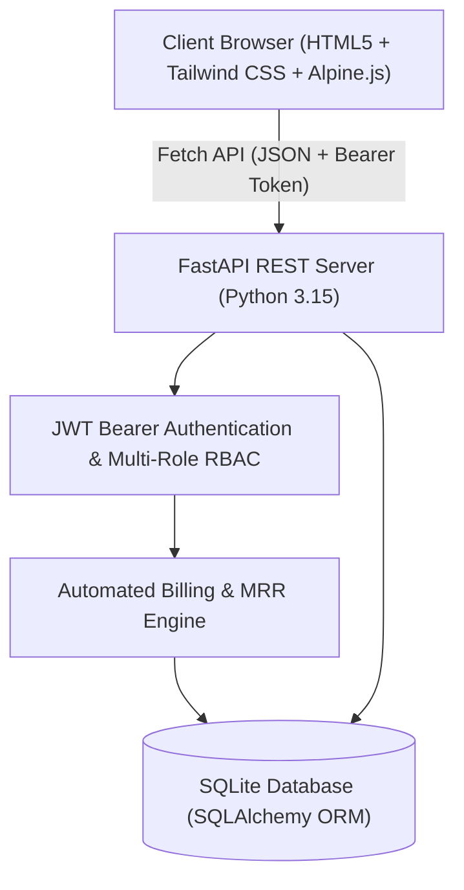
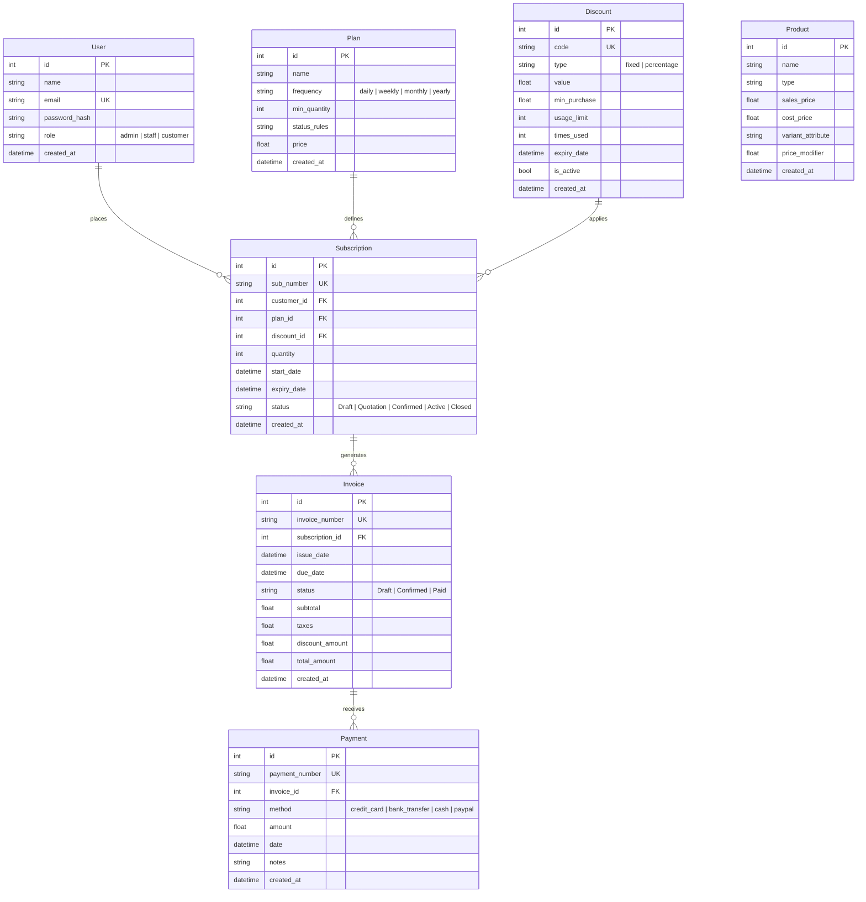

# INTRINSIC - Subscription & Invoicing Management System

**INTRINSIC** is an enterprise-grade, production-ready Subscription, Invoicing, and Billing Management System built for the **Odoo Makeathon**. 

It is engineered with a **Python (FastAPI)** and **SQLite (SQLAlchemy ORM)** backend, paired with an ultra-responsive, zero-build-step frontend using **HTML5, Tailwind CSS, and Alpine.js**.

---

## 1. System Architecture & Tech Stack



### Backend & Database
- **FastAPI**: Asynchronous high-performance REST API with automatic OpenAPI (Swagger) documentation.
- **SQLite + SQLAlchemy ORM**: Relational persistence with foreign keys, cascading deletions, and transactional integrity.
- **Security & PBKDF2 Hashing**: Cryptographic password hashing (`hashlib.pbkdf2_hmac` SHA-256 with per-user salt) and PyJWT Bearer token verification.
- **User-Friendly Error Handling**: Custom exception handlers translating Pydantic 422 validation arrays into polite, human-readable notifications.

### Frontend & Client Experience
- **Rebranded as INTRINSIC**: Cohesive typography, custom badge iconography, and clean branding.
- **Mandatory Initial Landing & Auth Flow**: Boots directly into a full-screen Sign In / Register landing screen. Dashboard, navigation, and core features remain completely hidden until authentication succeeds. A prominent **Sign Out** button terminates the session and returns immediately to the initial auth screen.
- **Fluid Screen Utilization**: Completely removed artificial container constraints (`max-w-7xl` or margin cutoffs). The UI fluidly adapts to 100% of the display width.
- **Cross-Platform Responsiveness**: Mobile-optimized collapsible navigation drawer and stacked touch-friendly actions, alongside a desktop sidebar and multi-column data views.
- **Theme Switcher (Dark & Bright Mode)**: Seamless toggle between dark and bright high-contrast color schemes with persistent state saved in `localStorage`.
- **Zero-Emoji Policy**: Strictly professional vector typography and SVG icons across all views and alerts.

---

## 2. Relational Database Schema Design (ERD)



---

## 3. The API Contract (Integration Specification)

### Authentication
- `POST /api/auth/register`: Register user `{ name, email, password, role }`
- `POST /api/auth/login`: Authenticate and receive signed JWT `{ email, password }`
- `GET /api/auth/me`: Profile of the currently authenticated user

### Catalog & Plans
- `GET /api/plans`: Retrieve all subscription tiers and recurrence rules
- `POST /api/plans`: (Admin only) Create subscription plan `{ name, frequency, min_quantity, price, status_rules }`
- `GET /api/products`: Retrieve product catalog and variant modifiers
- `POST /api/products`: (Admin only) Create product/variant `{ name, type, sales_price, cost_price, variant_attribute, price_modifier }`

### Discounts
- `GET /api/discounts`: (Admin/Staff) List promotional discount rules
- `POST /api/discounts`: (Admin only) Create discount `{ code, type, value, min_purchase, usage_limit, expiry_date }`
- `GET /api/discounts/validate/{code}?amount=X`: Validate code against proposed order subtotal

### Subscriptions & Lifecycle Engine
- `POST /api/subscriptions`: Create quote or contract `{ plan_id, quantity, discount_code, status }`
- `GET /api/subscriptions`: List subscriptions (filtered by role; customer views self, staff/admin view all)
- `GET /api/subscriptions/{id}`: Detailed contract view with invoices and customer details
- `PATCH /api/subscriptions/{id}/status`: Lifecycle transitions:
  - `Draft` -> `Quotation` -> `Confirmed` -> `Active` -> `Closed`
  - Transitioning to `Active` automatically generates the initial billing invoice

### Invoicing & Billing
- `POST /api/invoices/generate`: Automated billing engine trigger (Bulk across active renewal cycles or single `subscription_id`)
- `GET /api/invoices`: List billing statements (filtered by role)
- `GET /api/invoices/{id}`: Invoice statement with recorded payments
- `POST /api/invoices/{id}/pay`: Record settlement payment `{ method, amount, notes }`

### Finance Dashboard Metrics
- `GET /api/dashboard/metrics`:
  - `mrr`: Normalized Monthly Recurring Revenue
  - `active_subscriptions_count`: Count of active subscription contracts
  - `overdue_invoices_count` & `overdue_invoices_amount`: Pending/due payment obligations
  - `total_revenue`: Cleared lifetime collections
  - `recent_revenue_logs`: Chronological payment audit log

---

## 4. Demo Accounts & Instant Personas

The system automatically initializes and seeds demo data on first startup:

| Persona | Name | Email | Password | Role & Permissions |
| :--- | :--- | :--- | :--- | :--- |
| **Administrator** | Alex Morgan | `admin@company.com` | `admin123` | Full platform control: Plans, Products, Discounts, Billing Engine, MRR |
| **Internal Staff** | Taylor Swift | `staff@company.com` | `staff123` | Contract lifecycle transitions, quote issuing, billing cycle trigger |
| **Customer 1** | John Doe | `john.doe@enterprise.com` | `customer123` | Self-service contract creation, view invoices, instant payment |
| **Customer 2** | Sarah Connor | `sarah.connor@cyberdyne.io` | `customer123` | Self-service contracts and invoice settlement |

> **Evaluation Shortcut**: On the initial full-screen login page, use the **1-Click Instant Persona Evaluation** buttons to test any persona without manual typing.

---

## 5. Local Setup & Quickstart

```powershell
cd C:\Users\abhin\.gemini\antigravity\scratch\subscription_billing_system

# Install dependencies
pip install -r requirements.txt

# Run server
python run_server.py
```

* **Web UI**: [http://127.0.0.1:8000](http://127.0.0.1:8000)
* **Interactive API Docs (Swagger UI)**: [http://127.0.0.1:8000/docs](http://127.0.0.1:8000/docs)

---

## 6. Running the Automated Test Suite

```powershell
# Core API & lifecycle transition tests
python tests/test_api.py

# Edge cases, RBAC denial, discount thresholds, and latency benchmarks
python tests/test_edge_cases.py
```
